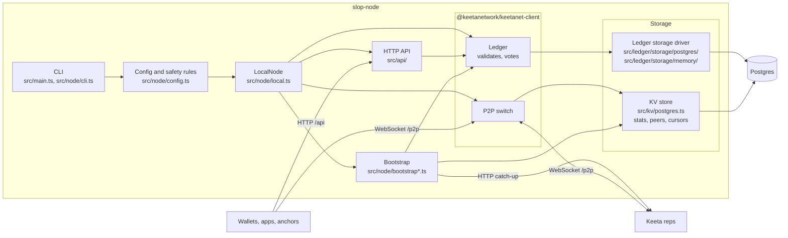

# Slop Node

...the first publicly available node software for Keeta. Created with heavy use of AI agents.

[Keeta][keeta-home] is a Delegated Proof of Stake (DPoS) Layer-1 designed for high-throughput asset transfers. Its ledger is a [Directed Acyclic Graph (DAG)][whitepaper] of per-account block chains rather than a single linearly-ordered chain like you'd find with typical networks. Each account publishes blocks to its own chain, and operations in those blocks reference other accounts' chains, which lets independent accounts publish concurrently.

## Get started

### 0. Requirements

This assumes you have Docker/Podman set up already and that you can run Linux containers. You'll need **40 GB of free disk space, 4 GB of RAM (8 GB is comfortable), and 2 CPU cores.** The Keeta ledger takes about 23 GB right now, the rest is headroom for the database. The first sync takes a day or two, after that the node barely uses anything.

For a peering node or a rep you'll also need a domain that you plan to keep, since other nodes remember it. Either ports 80 and 443 have to be reachable from the internet, or you need a free Cloudflare account to set up a tunnel.

### 1. Quickly download the `compose.yaml` file

```bash
curl -LO https://github.com/xescure/slop-node/releases/latest/download/compose.yaml
```

### 2./a Replica node

You need this one **if you just care about having a local copy of the entire Keeta ledger.** A local ledger lets you run manual queries about the state of the network (accounts, balances, tokens, etc.). Some of this information would be painful, or downright impossible to obtain from remote nodes. A replica node also helps you trust the network more, as the chain state is verified locally and compromised nodes can't mislead you.

```bash
echo "COMPOSE_PROFILES=replica" >> .env
docker compose up -d
```

You also have the option to listen to incoming blocks without replicating the local state. For this purpose I recommend the Anchor SDK's [`BlockListener`][block-listener].

### 2./b Peering node

**A peering node is for actually participating in the Keeta network.** Your node will actively receive updates from the network, and it will forward these blocks to other nodes. This process creates more and more active copies of the ledger on independent servers. This is a crucial step towards building a robust and decentralized network.

```bash
# You can save it down, but for a peering node it's not essential
echo "KEETANET_LOCAL_NODE_SEED=$(openssl rand -hex 32)" >> .env

# Add your own domain, and make sure it points to your server
echo "SLOP_NODE_DOMAIN=node.example.com" >> .env

# Alternatively use `cloudflared` for an easier experience:
# echo "COMPOSE_PROFILES=peer,cloudflare" >> .env
# echo "CLOUDFLARE_TUNNEL_TOKEN=<your tunnel token>" >> .env
# In Cloudflare, route the tunnel's hostname to http://node:8080
echo "COMPOSE_PROFILES=peer,caddy" >> .env

docker compose up -d
```

### 2./c Representative (rep)

We're in the big leagues now. **Representatives are exclusively responsible for the network level security of Keeta.** They verify each block, signature, and operation that goes into the ledger. If you send a simple transfer of `1 $KTA`, underneath potentially dozens of reps will have verified that you had proper permissions, enough funds, and so on. Reps may earn (and redistribute) transaction fees on blocks they validate. However, this is **not enabled** on Keeta mainnet yet.

```bash
# Save this one down and also keep it secure!
echo "KEETANET_LOCAL_NODE_SEED=$(openssl rand -hex 32)" >> .env

# Add your own domain, and make sure it points to your server
echo "SLOP_NODE_DOMAIN=rep.example.com" >> .env

# Alternatively use `cloudflared` for an easier experience:
# echo "COMPOSE_PROFILES=rep,cloudflare" >> .env
# echo "CLOUDFLARE_TUNNEL_TOKEN=<your tunnel token>" >> .env
# In Cloudflare, route the tunnel's hostname to http://node:8080
echo "COMPOSE_PROFILES=rep,caddy" >> .env

docker compose up -d
```

### 3. Make sure it works

Your node should be up in a few seconds, and it starts catching up with the network right away. **The first sync is done once your node logs a line ending in "the peers are read from there on".** After that it just keeps up with the new blocks.

```bash
curl http://localhost:8080/api/node/version

# For a peering node or a rep, check your domain too
curl https://node.example.com/api/node/version

docker compose logs -f
docker compose logs | grep "the peers are read from there on"
```

## Motivation

The true digitalization of finance, especially in cross-border contexts, has stalled. Blockchain technology may bring about a new chapter where money is as fast as the internet is. However, current blockchains are unscalable and clunky and I don't see them being the next financial backbone at all.

Keeta is insanely fast. It can facilitate tens or even hundreds of millions of transactions per second. Settlement is sub-second and deterministic. Keeta's mental model maps cleanly to payments, and it doesn't try to force smart contracts where they're not needed. Tokens can be equipped with KYC/AML/sanctions controls for assets and jurisdictions that so require. Ramps, bridges, and liquidity providers are not an afterthought, but native first-class participants of the network. Using these components, for the first time in history, a solo developer with an AI agent can set up an entire neobank in just minutes. I believe Keeta will power a new wave of financial apps, where the best user experience, security, and feature set will win. Builders can focus on building, and the open and interoperable network takes care of providing them with the best infrastructure, instead of depending on closed-room financial deals.

I can't wait to see how Keeta develops, but right now its source code isn't fully public and third parties are not able to run their own nodes. I fed Claude Opus 5.5 the public parts of the code, my understanding of Keeta, its docs, forum discussions, and a few *ehm* proprietary sources. Then came about 6 hours of refinement and setting up an environment where the agent could evaluate itself.

**The end result is a fully functional Keeta node.** It's primarily for experimentation, please don't rely on it for high value applications yet.

## Architecture



## Ledger schema

```mermaid
erDiagram
    accounts ||--o{ blocks : publishes
    accounts ||--o{ chain : "has, by height"
    accounts ||--o| heads : "has latest"
    accounts ||--o{ votes : issues
    accounts ||--o{ balances : holds
    accounts ||--o| supplies : "token supply"
    accounts ||--o| weights : "rep weight"
    accounts ||--o| delegations : "delegates to"
    accounts ||--o| account_info : describes
    accounts ||--o{ acls : "principal, entity, target"
    accounts ||--o{ certificates : holds
    accounts ||--o{ history : "takes part in"

    staples ||--|{ blocks : contains
    staples ||--o{ history : "listed in"
    votes ||--|{ vote_blocks : covers
    blocks ||--o{ vote_blocks : "voted in"
    blocks ||--o| chain : "placed at"
    blocks ||--o{ idempotent_keys : "keyed by"

    deferred_staples ||--o{ deferred_waits : "waits for block"
    deferred_staples ||--o{ deferred_blocks : "builds on previous"
    deferred_staples ||--o| deferred_checks : "due for a check"

    accounts {
        bigint id PK
        text public_key UK
        smallint key_type
        hash32 first_staple
    }
    staples {
        hash32 blocks_hash PK
        timestamptz staple_time
        timestamptz moment
        bigint sequence UK
        bit256 checksum
        bytea bytes
    }
    blocks {
        hash32 hash PK
        ledger_name ledger "main or side"
        bigint account_id FK
        hash32 previous
        hash32 staple FK
        bytea bytes
    }
    votes {
        bigint id PK
        ledger_name ledger "main or side"
        bigint issuer_id FK
        hash32 blocks_hash
        boolean permanent
        bytea bytes
    }
    vote_blocks {
        bigint vote_id PK, FK
        int position PK
        hash32 block_hash FK
    }
    chain {
        bigint account_id PK, FK
        bigint height PK
        hash32 block_hash FK
    }
    heads {
        bigint account_id PK, FK
        hash32 block_hash FK
        bigint height
    }
    history {
        bigint account_id PK, FK
        timestamptz staple_time PK
        hash32 blocks_hash PK, FK
    }
    balances {
        bigint account_id PK, FK
        bigint token_id PK, FK
        numeric balance
    }
    supplies {
        bigint token_id PK, FK
        numeric supply
    }
    weights {
        bigint representative_id PK, FK
        numeric weight
    }
    delegations {
        bigint account_id PK, FK
        bigint representative_id FK
    }
    account_info {
        bigint account_id PK, FK
        text name
        text description
        text metadata
    }
    acls {
        bigint principal_id FK
        hash32 certificate
        bigint entity_id FK
        bigint target_id FK
        numeric base_permissions
        numeric external_permissions
    }
    certificates {
        bigint account_id PK, FK
        hash32 hash PK
        bytea certificate
    }
    idempotent_keys {
        hash32 key PK
        ledger_name ledger PK
        hash32 block_hash PK, FK
    }
    deferred_staples {
        hash32 blocks_hash PK
        bytea bytes
        timestamptz latest_vote_from
    }
    deferred_waits {
        hash32 block_hash PK
        hash32 blocks_hash PK, FK
    }
    deferred_blocks {
        hash32 blocks_hash PK, FK
        hash32 previous PK
    }
    deferred_checks {
        hash32 blocks_hash PK, FK
    }
    bootstrap_stage {
        hash32 blocks_hash PK
        timestamptz first_vote_from
        timestamptz last_vote_from
        bytea bytes
    }
    ledger_checksum {
        smallint shard PK
        bit256 checksum
    }
    kv_entries {
        text arena PK
        text key PK
        json value
        timestamptz expires_at
    }
```




[keeta-home]: https://keeta.com/
[whitepaper]: https://keeta.com/whitepaper.pdf
[block-listener]: https://github.com/KeetaNetwork/anchor/blob/main/src/lib/block-listener.ts
